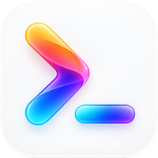
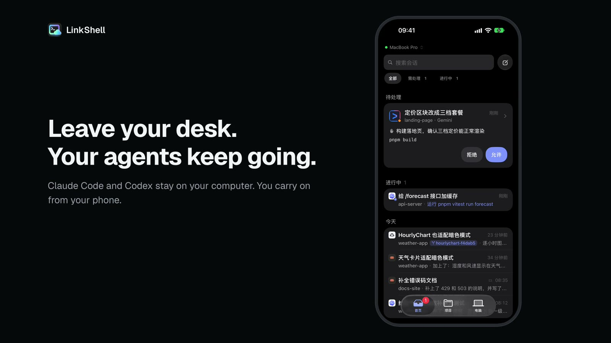
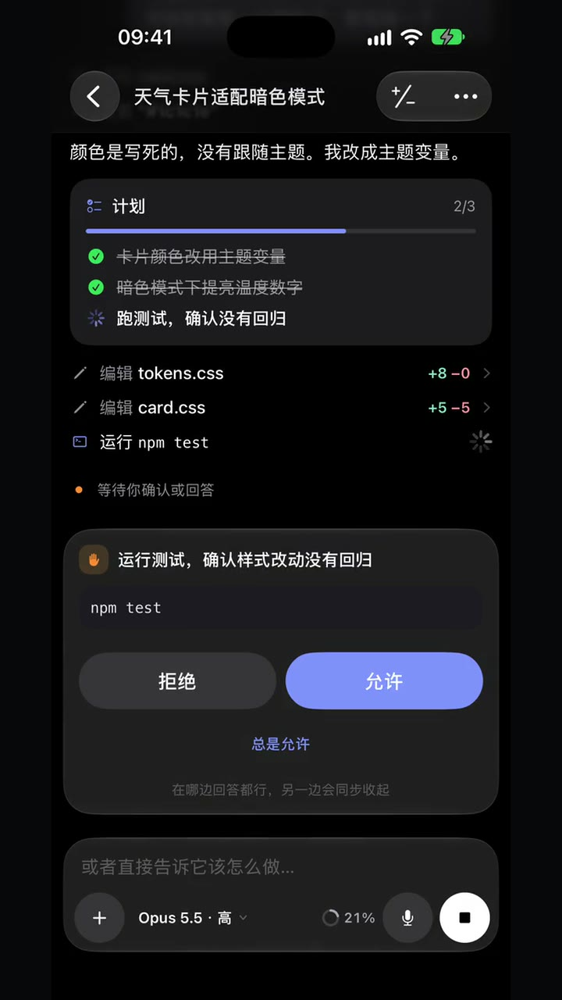
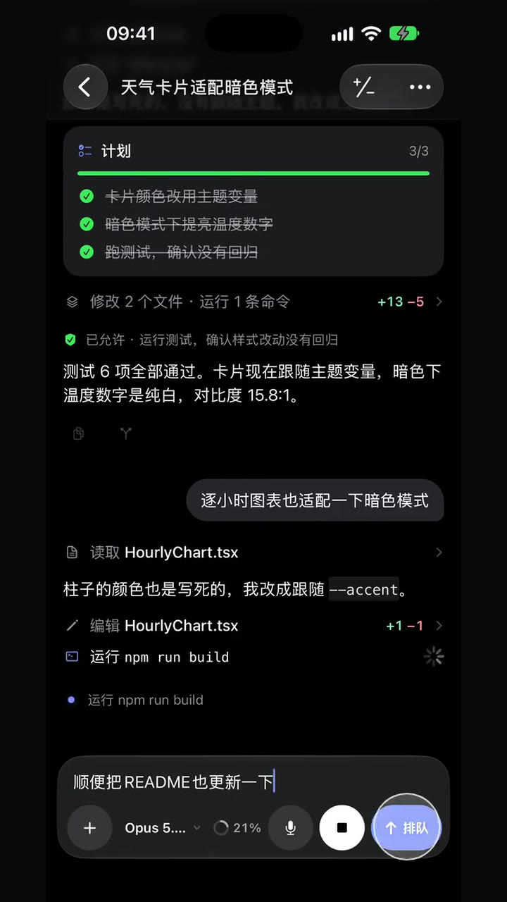
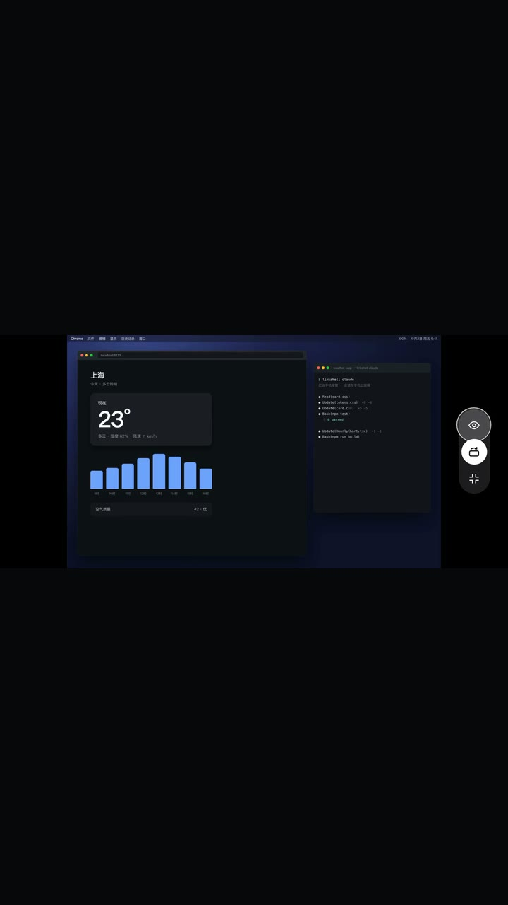

<p align="center">
  
</p>

<h1 align="center">LinkShell</h1>

<p align="center">
  <strong>Leave your desk. Your agents keep going.</strong><br />
  Follow, steer and approve the coding agents running on your computer, from your phone.
</p>

<p align="center">
  <a href="https://www.npmjs.com/package/linkshell-cli"></a>
  <a href="https://github.com/LiuTianjie/LinkShell/actions/workflows/test.yml"></a>
  <a href="LICENSE"></a>
</p>

<p align="center">
  <a href="https://linkshell.itool.tech/en/">Website</a> ·
  <a href="https://linkshell.itool.tech/en/docs/">Docs</a> ·
  <a href="https://apps.apple.com/cn/app/linkshell/id6761547516">iPhone</a> ·
  <a href="https://github.com/LiuTianjie/LinkShell/releases/latest">Android</a> ·
  <a href="#install-on-your-computer">Mac</a> ·
  <a href="README_CN.md">简体中文</a>
</p>

<p align="center">
  <a href="https://linkshell.itool.tech/assets/promo/linkshell-en.mp4"></a><br />
  <sub>▶ <a href="https://linkshell.itool.tech/assets/promo/linkshell-en.mp4">Watch the film</a> (50 s, recorded from the app)</sub>
</p>

Claude Code, Codex and other coding agents keep running on your computer. From your phone you watch them work, approve what they ask for, send a message into a running turn, and open the computer's screen when you need to. When you sit down again, the session is still in your terminal. Your code and the agent processes never leave your machine, and everything between phone and computer is end-to-end encrypted.

Works with iPhone (including iPhone Duo), Apple Watch, Android and the browser, against macOS, Linux or Windows.

## What it does

<table>
  <tr>
    <td width="33%" valign="top">
      <br />
      <strong>Follow the work, approve with a tap</strong><br />
      Replies stream in; plans, tool calls and diffs update live. Permission requests and questions come to the phone, the Lock Screen and the watch.
    </td>
    <td width="33%" valign="top">
      <br />
      <strong>Cut in while it is busy</strong><br />
      Messages sent mid-turn wait in a queue. Reorder them, take one back, or steer one straight into the running turn. Stop a turn from the phone.
    </td>
    <td width="33%" valign="top">
      <br />
      <strong>Your Mac, in your pocket</strong><br />
      Open the real desktop, zoom in on the details and take the mouse and keyboard. Up to 3840 px wide, with iOS display support up to 120 Hz.
    </td>
  </tr>
</table>

- **Lock Screen and Apple Watch.** A Live Activity shows progress and pending requests, with Deny / Allow on the card (iOS 17+). The watch app follows sessions, answers simple requests and sends short replies, on its own connection or through the iPhone. See [Apple Watch](docs/v2/apple-watch.md) and [Live Activities](docs/v2/live-activity.md).
- **Hand sessions back and forth.** Start an agent with `linkshell claude` or `linkshell codex` and pass it between the terminal and the phone. Sessions opened in plain `claude` / `codex` or the Claude and Codex desktop apps can be followed too.
- **Computer Use, from the phone.** Ask Codex to use the browser or desktop apps on your Mac and watch it live in a floating preview. See [Computer Use](docs/v2/computer-use.md).
- **Questions, plans and goals.** Answer an agent's structured questions; use plan mode, `/goal`, slash commands and your skills. See [agent questions](docs/v2/agent-questions.md) and [commands and goals](docs/v2/commands-and-goals.md).
- **Sub-agents, Workflows and background tasks.** Follow a Claude Workflow by phase, open each sub-agent's conversation, and check commands that outlive a reply. See [background tasks](docs/v2/background-tasks.md).
- **Forks and worktrees.** Fork a session from any reply to try another direction, in the same directory or a new git worktree.
- **Side conversations.** Ask about a session without interrupting it or adding to it, the agent's own way: Codex's `/side` (a read-only temporary fork), Claude's and Grok's `/btw`.
- **A real terminal and localhost.** Terminals on your computer with a Ctrl / Esc / Tab / arrow-key bar, and your dev server's port on the phone over the same encrypted channel, with no open ports.
- **Files, settings and connections.** Browse the project, send photos and files to the agent, change model, effort and permission mode, configure MCP servers and custom [ACP](docs/v2/acp-support.md) agents.
- **Adaptive layouts.** iPhone Duo puts the conversation beside its changes or a preview, and adapts to folds and orientation; iPad uses a split view.
- **Search and housekeeping.** Search sessions by title, preview, path, branch or agent; rename, archive and delete, synced to Codex and Claude's own records where they support it. See [session recovery](docs/v2/session-recovery.md).

## Install on your computer

**Mac: the standalone app** (macOS 13+, [Apple Silicon](https://github.com/LiuTianjie/LinkShell/releases/download/desktop-v0.10.79/LinkShell-0.10.79-arm64.dmg) · [Intel](https://github.com/LiuTianjie/LinkShell/releases/download/desktop-v0.10.79/LinkShell-0.10.79-x64.dmg)). Drag it into Applications, open it and sign in, then turn on Screen Recording and Accessibility in its Settings. It brings its own CLI, Host and Node and updates them together; nothing else is needed. It also gives you a desktop workspace for this Mac or another computer, token usage by agent, and launch at login. See the [desktop guide](docs/mac-desktop.md).

**Windows: desktop preview** (Windows 10 1809+ / Windows 11 x64, [installer](https://github.com/LiuTianjie/LinkShell/releases/download/desktop-v0.10.79/LinkShell-Setup-0.10.79-windows-x64.exe) · [portable ZIP](https://github.com/LiuTianjie/LinkShell/releases/download/desktop-v0.10.79/LinkShell-0.10.79-windows-x64.zip)). Both bundle Node, CLI, Host, ConPTY and screen components, with the same desktop workspace as macOS for conversations, terminals, files and port previews. The window is the same Electron app as on macOS and needs no WebView2 Runtime. Direct H.264 video and JPEG fallback support viewing and control on the unlocked desktop. Packages are unsigned and may show unknown-publisher or SmartScreen prompts; see the [Windows guide](docs/windows-desktop.md) for installation and validation limits.

**macOS or Linux: the CLI** (Node.js 22.13 or newer).

```bash
npm i -g linkshell-cli
linkshell setup
```

`linkshell setup` starts the host in the background, walks you through the two macOS permissions the screen needs (a LinkShell window takes you to each switch), and connects your phone. Run it again any time; each part also has its own command. Homebrew and an install script work too:

```bash
brew install LiuTianjie/linkshell/linkshell
curl -fsSL https://liutianjie.github.io/LinkShell/install.sh | sh
```

On Linux the screen can be watched but not controlled, and needs `ffmpeg` with an X11 display. Intel Macs are supported; real-hardware capture performance on Intel is not yet validated.

The agents you use must be installed and signed in on the computer as usual (`claude`, `codex login`, `gemini`, `copilot login`, …). LinkShell runs them as you, with your login shell's environment, and never handles their accounts or API keys.

## Connect your phone

Get the app: [iPhone](https://apps.apple.com/cn/app/linkshell/id6761547516) · [Android](https://github.com/LiuTianjie/LinkShell/releases/latest). Then either:

- **Pro: the official gateway.** Sign in on the computer (`linkshell login`, or in the Mac app) and in the phone app with the same account. The computer appears by itself.
- **Free: your own gateway.** Run a gateway ([below](#run-your-own-gateway)), point the host at it and pair each phone once by QR code or six-digit code:

  ```bash
  linkshell host --gateway wss://gw.example.com --daemon
  linkshell pair    # in the app: Computers → Add computer
  ```

Every feature is free; Pro adds the hosted gateway (¥9.9 a month or ¥99 a year). Buy an activation code on [Liandong Xiaopu](https://pay.ldxp.cn/item/7lgv1s) and redeem it in the phone app's Account page, the Mac app, the web workspace, or [iTool Settings](https://itool.tech/en/settings). LinkShell Pro and iTool Pro are the same membership. See [Pro redemption](docs/v2/pro-redemption.md).

The gateway also serves a browser client at its root URL, with the same pairing or account sign-in. See [the web client](apps/web/README.md).

## Agents

| Agent | Mode | What you get |
| --- | --- | --- |
| **Codex** | Shared | `linkshell codex` and the phone are live at once; either side can send, interrupt and approve |
| **Claude Code** | Handoff | Claude's own UI at your desk; a message from the phone takes over, any key at the computer takes it back |
| **Gemini CLI, GitHub Copilot, OpenCode, Cursor, Grok** | Remote | Start and continue sessions from the phone over the [Agent Client Protocol](https://agentclientprotocol.com): live output, approvals, modes and models |
| **Any CLI** | Terminal | A terminal on the computer, viewed and typed into from the phone |

Codex works with ChatGPT sign-in, an API key or a custom provider (including one managed by CC Switch). A Claude session opened in the Claude desktop app can be followed and continued from the phone, but the desktop app only shows what the phone did after a restart; use `linkshell claude` to hand a session back and forth.

<details>
<summary>What each agent supports from the phone</summary>

| | Codex | Claude Code | Gemini, Copilot and others |
| --- | --- | --- | --- |
| A message during a running turn | joins the turn | joins the turn | stops the turn, then runs |
| Fork a session, or from a reply | native | native | by LinkShell: the conversation is passed as text |
| Side conversation | `/side`: a read-only temporary fork | `/btw`: answered from the conversation, no tools | Grok's `/btw`; not in the others |
| Sessions in git worktrees | yes | yes | yes |
| Slash commands | `/compact`, `/review`, `/init`, your skills | Claude's own list and your skills | whatever the agent offers |
| Questions for you | yes, including Desktop asynchronous questions | yes | Cursor choices, Grok questions, standard ACP forms |
| Plan mode | a setting on the phone | a permission mode | whatever modes the agent offers |
| Persistent goals | set, pause, resume, clear, token budget | set and clear, when `/goal` is available | not integrated |
| Background commands | status, output, stop one task | Bash / Monitor status and output | not integrated |

</details>

## Run your own gateway

A gateway relays encrypted frames and brokers pairing; it never sees your code or conversations. A self-hosted one is the same program as the official gateway, without accounts.

```bash
# with the CLI
linkshell gateway --port 8787 --daemon

# or with Docker
docker run -d --name linkshell-gateway -p 8787:8787 \
  -v linkshell-gateway:/data nickname4th/linkshell-gateway
```

Its only state is one SQLite file of public keys and pairings: `~/.linkshell/relay.db` with the CLI, `/data/relay.db` in the container. Keep it and phones stay paired. On the internet, put an HTTPS reverse proxy in front and use `wss://your-domain`; at home the gateway can run on the same computer (`linkshell host --gateway ws://<LAN-IP>:8787`). See the [deployment guide](docs/deploy.md).

## Security

- **End-to-end encryption.** Phone and computer agree on keys signed by their long-term identities; every frame after that is sealed with XChaCha20-Poly1305. Gateways relay ciphertext only. The direct peer-to-peer channel for the screen and previews is negotiated over that tunnel.
- **Pairing grants access.** A paired phone can do what you can do in a terminal on that computer. Pair only devices you trust and keep pairing codes to yourself; remove a phone with `linkshell devices remove <name>`.
- **Your accounts stay yours.** Agents run as your user with their own sign-in. Pro covers the gateway only.
- **Local state.** Sessions, history and keys live in `~/.linkshell` on the computer (`LINKSHELL_HOME` moves it).

Architecture details: [design](docs/v2/architecture.md) and [remote desktop](docs/v2/screen-realtime.md).

## Commands

| Task | Command |
| --- | --- |
| Set up a computer: host, screen permissions, phone | `linkshell setup` |
| Start the host in the background / see it / stop it | `linkshell host --daemon` / `linkshell host status` / `linkshell host stop` |
| Pair a phone (own gateway) | `linkshell pair` |
| List or remove paired phones | `linkshell devices` / `linkshell devices remove <name>` |
| Use the official gateway (Pro) | `linkshell login` / `linkshell logout` |
| Claude Code / Codex, shareable with the phone | `linkshell claude` / `linkshell codex` (arguments pass through) |
| Set up or check the screen | `linkshell screen` / `linkshell screen --check` |
| Open the Mac status app | `linkshell app` |
| Run a gateway | `linkshell gateway [--port 8787] [--daemon]` |
| Check the environment | `linkshell doctor` |
| Upgrade (restarts a running host, keeping pairings and history) | `linkshell upgrade` |

The standalone Mac app updates itself from its Updates page.

> **Coming from 1.x?** 2.0 changed both the app and the computer side: upgrade both and pair again.

## Development

A pnpm workspace; Node.js 22.13 or newer.

```bash
git clone https://github.com/LiuTianjie/LinkShell.git
cd LinkShell
pnpm install
pnpm build && pnpm typecheck && pnpm test
```

On macOS the full build also builds LinkShell.app and needs Xcode's Swift toolchain. On Windows it builds the desktop and screen helper with .NET Framework 4.8; `pnpm -r --filter "./packages/*" build` builds the TypeScript packages only (what Linux CI runs). To work on the app, run a development host with its own state directory, then Metro:

```bash
LINKSHELL_HOME="$HOME/.linkshell-dev" pnpm dev:cli host --dev-port 7878
pnpm dev:app
```

| Directory | What it is |
| --- | --- |
| `packages/wire` | Session model, JSON-RPC methods, end-to-end encryption, relay client |
| `packages/host` | The host daemon: agent drivers (Codex, Claude, ACP), terminals, ports, screen |
| `packages/gateway` | The relay: routing encrypted frames, pairing, accounts |
| `packages/cli` | `linkshell`: host, pairing, agent launchers, gateway, login |
| `packages/client-core` | Client state and timeline shared by the apps |
| `apps/client` | The iPhone, Apple Watch and Android app (Expo / React Native) |
| `apps/mac` | LinkShell.app: screen capture, video, input, permissions, desktop workspace |
| `apps/web` | The browser client served by the gateway |
| `docs/site` | The website and the install script |

Focused bug reports and pull requests are welcome. Include the CLI version, OS, agent and a minimal reproduction, and redact pairing codes and tokens. Releases follow the [release SOP](docs/release-sop.md).

## Support the project

Sponsored by [AI18N](https://ai18n.chat/), an AI API gateway with OpenAI- and Anthropic-compatible interfaces. LinkShell is also on [Product Hunt](https://www.producthunt.com/products/linkshell).

<details>
<summary>Buy the author a coffee</summary>

<p>
  
  
</p>

</details>

## License

[MIT](LICENSE)
