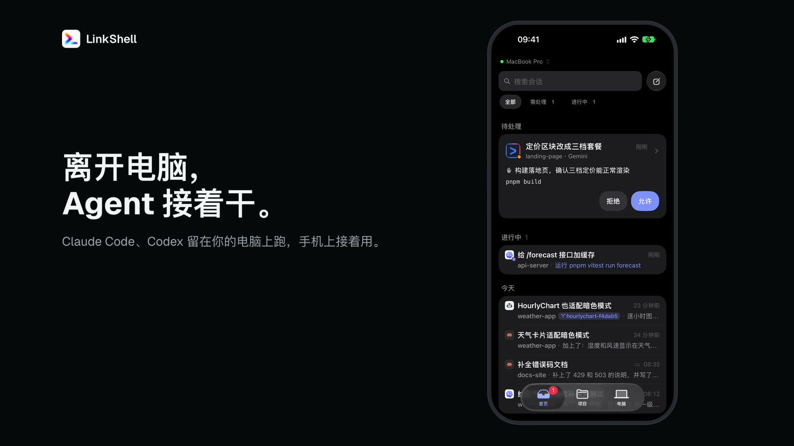

<p align="center">
  
</p>

<h1 align="center">LinkShell</h1>

<p align="center">
  <strong>离开电脑，Agent 接着干。</strong><br />
  在手机上跟进、插话、审批电脑里正在跑的编程 Agent。
</p>

<p align="center">
  <a href="https://www.npmjs.com/package/linkshell-cli"></a>
  <a href="https://github.com/LiuTianjie/LinkShell/actions/workflows/test.yml"></a>
  <a href="LICENSE"></a>
</p>

<p align="center">
  <a href="https://linkshell.itool.tech/">官网</a> ·
  <a href="https://linkshell.itool.tech/docs/">文档</a> ·
  <a href="https://apps.apple.com/cn/app/linkshell/id6761547516">iPhone</a> ·
  <a href="https://github.com/LiuTianjie/LinkShell/releases/latest">Android</a> ·
  <a href="#在电脑上安装">Mac</a> ·
  <a href="README.md">English</a>
</p>

<p align="center">
  <a href="https://linkshell.itool.tech/assets/promo/linkshell-2.0.mp4"></a><br />
  <sub>▶ <a href="https://linkshell.itool.tech/assets/promo/linkshell-2.0.mp4">看介绍片</a>（50 秒，App 实录）</sub>
</p>

Claude Code、Codex 这些编程 Agent 继续在你的电脑上跑。你在手机上看它干活、批准它的请求、往正在进行的这一轮里插话，需要时直接打开电脑屏幕。回到电脑前，会话还在终端里。代码和 Agent 进程都不离开你的电脑，手机和电脑之间的数据全程端到端加密。

支持 iPhone（含 iPhone Duo）、Apple Watch、Android 和浏览器；电脑端支持 macOS、Linux 与 Windows。

## 能做什么

<table>
  <tr>
    <td width="33%" valign="top">
      <br />
      <strong>看着它干活，点一下批准</strong><br />
      回复逐字出现，计划、工具调用和 diff 实时更新。权限请求和提问推到手机、锁屏和手表上。
    </td>
    <td width="33%" valign="top">
      <br />
      <strong>它正忙，你照样能插话</strong><br />
      忙的时候发的消息先排队：可以调整顺序、取回重写，或者直接插进当前这一轮。手机上也能停下电脑上正在跑的那一轮。
    </td>
    <td width="33%" valign="top">
      <br />
      <strong>把 Mac 桌面装进口袋</strong><br />
      打开真实桌面，放大看清细节，接手鼠标和键盘。画面最高 3840 像素宽，iOS 适配最高 120 Hz 显示。
    </td>
  </tr>
</table>

- **锁屏和 Apple Watch。** 实时活动在锁屏上显示进度和待确认的请求，卡片上直接有「拒绝 / 允许」（iOS 17 及以上）。手表 App 可以看会话、回简单的请求、发短消息，可独立连接，也可经 iPhone 连接。详见 [Apple Watch](docs/v2/apple-watch.md) 和[实时活动](docs/v2/live-activity.md)。
- **在终端和手机之间接力。** 用 `linkshell claude` 或 `linkshell codex` 启动 Agent，会话可以在终端和手机之间来回交接。普通的 `claude` / `codex`，以及 Claude 和 Codex 桌面 App 里打开的会话，也能在手机上跟进。
- **手机上用 Computer Use。** 让 Codex 操作 Mac 上的浏览器和桌面应用，在会话浮窗里实时看画面。详见 [Computer Use](docs/v2/computer-use.md)。
- **提问、计划和目标。** 回答 Agent 的结构化提问；使用计划模式、`/goal`、斜杠命令和你的 skills。详见 [Agent 提问](docs/v2/agent-questions.md)和[命令与目标](docs/v2/commands-and-goals.md)。
- **子 Agent、工作流和后台任务。** 按阶段跟进 Claude Workflow，打开每个子 Agent 的对话，查看回复结束后仍在运行的命令。详见[后台任务](docs/v2/background-tasks.md)。
- **分叉和 worktree。** 从任意一条回复分叉出新会话换个思路，可以留在当前目录，也可以放进新的 git worktree。
- **旁支对话。** 问一个关于会话的问题，不打断它、也不进入会话，用 Agent 自己的方式：Codex 的 `/side`（只读的临时分叉），Claude 和 Grok 的 `/btw`。
- **真终端和 localhost。** 电脑上的终端，带 Ctrl、Esc、Tab 和方向键工具栏；dev server 的端口走同一条加密通道在手机上打开，不用暴露端口。
- **文件、设置和连接。** 浏览项目文件，把照片和文件传给 Agent；修改模型、思考强度和权限模式；配置 MCP 服务和自定义 [ACP](docs/v2/acp-support.md) Agent。
- **适应不同屏幕。** iPhone Duo 展开时对话与改动或预览并排，并随折叠和方向调整；iPad 使用分栏布局。
- **搜索和整理。** 按标题、预览、路径、分支或 Agent 搜索会话；重命名、归档、删除，Codex 和 Claude 支持的部分同步到它们自己的记录。详见[会话恢复](docs/v2/session-recovery.md)。

## 在电脑上安装

**Mac：独立 App**（macOS 13 及以上，[Apple Silicon](https://github.com/LiuTianjie/LinkShell/releases/download/desktop-v0.10.78/LinkShell-0.10.78-arm64.dmg) · [Intel](https://github.com/LiuTianjie/LinkShell/releases/download/desktop-v0.10.78/LinkShell-0.10.78-x64.dmg)）。拖入「应用程序」，打开后登录，再在设置里打开屏幕录制和辅助功能。App 自带 CLI、Host 和 Node，一起更新，不需要另装别的。它还提供桌面工作台（连本机或其他电脑）、按 Agent 统计的 Token 用量和开机自启。详见[桌面版说明](docs/mac-desktop.md)。

**Windows：桌面预览版**（Windows 10 1809+ / Windows 11 x64，[安装器](https://github.com/LiuTianjie/LinkShell/releases/download/desktop-v0.10.78/LinkShell-Setup-0.10.78-windows-x64.exe) · [便携 ZIP](https://github.com/LiuTianjie/LinkShell/releases/download/desktop-v0.10.78/LinkShell-0.10.78-windows-x64.zip)）。两者均内置 Node、CLI、Host、ConPTY 与屏幕组件，与 macOS 共用会话、终端、文件和端口预览工作台。窗口与 macOS 是同一个 Electron 应用，不需要 WebView2 Runtime。支持 H.264 视频直连、JPEG 回退和解锁桌面的鼠标键盘控制。安装包未签名，可能出现「未知发布者」或 SmartScreen 提示；安装与验证范围见 [Windows 桌面说明](docs/windows-desktop.md)。

**macOS 或 Linux：CLI**（Node.js 22.13 或更新版本）。

```bash
npm i -g linkshell-cli
linkshell setup
```

`linkshell setup` 在后台启动 host，带你完成看屏幕需要的两项 macOS 权限（会弹出 LinkShell 窗口，带你到每个开关前），再连上手机。随时可以再运行；每一步也有各自的命令。也可以用 Homebrew 或安装脚本：

```bash
brew install LiuTianjie/linkshell/linkshell
curl -fsSL https://liutianjie.github.io/LinkShell/install.sh | sh
```

Linux 上可以看屏幕但不能控制，需要 `ffmpeg` 和 X11 显示环境。支持 Intel Mac；Intel 真机上的采集性能尚未验证。

要用的 Agent 需要照常在电脑上安装并登录（`claude`、`codex login`、`gemini`、`copilot login` 等）。LinkShell 以你的用户身份、用你登录 shell 的环境变量运行它们，不经手它们的账号和 API Key。

## 连接手机

下载 App：[iPhone](https://apps.apple.com/cn/app/linkshell/id6761547516) · [Android](https://github.com/LiuTianjie/LinkShell/releases/latest)。然后任选一种：

- **Pro：官方网关。** 在电脑上登录（`linkshell login` 或 Mac App），手机 App 登录同一个账号，电脑自动出现。
- **免费：自建网关。** 先运行一个网关（见[下文](#自建网关)），让 host 连上它，每台手机扫码或输入 6 位码配对一次：

  ```bash
  linkshell host --gateway wss://gw.example.com --daemon
  linkshell pair    # 在 App 的「电脑 → 添加电脑」里扫码
  ```

全部功能免费；Pro 只多一个官方托管网关（¥9.9/月 或 ¥99/年）。在[链动小铺](https://pay.ldxp.cn/item/7lgv1s)购买激活码，然后在手机 App 的账户页、Mac App、网页工作区或 [iTool 设置](https://itool.tech/zh/settings)里兑换。LinkShell Pro 与 iTool Pro 是同一份会员。详见 [Pro 兑换](docs/v2/pro-redemption.md)。

网关根地址还提供浏览器客户端，同样支持配对或账号登录。详见[网页客户端](apps/web/README.md)。

## 支持的 Agent

| Agent | 方式 | 体验 |
| --- | --- | --- |
| **Codex** | 多端同步 | `linkshell codex` 打开的终端和手机同时在线，任何一端都能发消息、打断、审批 |
| **Claude Code** | 接力 | 电脑上用 Claude 自己的界面；手机发消息即接管，电脑按任意键收回 |
| **Gemini CLI、GitHub Copilot、OpenCode、Cursor、Grok** | 远程会话 | 通过 [Agent Client Protocol](https://agentclientprotocol.com) 在手机上新建、继续会话：实时输出、审批、模式和模型 |
| **任何命令行工具** | 终端 | 在电脑上开终端，手机上看和输入 |

Codex 可以用 ChatGPT 登录、API Key 或自定义服务商（包括 CC Switch 管理的配置）。在 Claude 桌面 App 里打开的会话，手机上也能跟进和继续，但桌面 App 要重启后才显示手机上做的内容；想来回接力，用 `linkshell claude` 启动。

<details>
<summary>各 Agent 在手机上的支持情况</summary>

| | Codex | Claude Code | Gemini、Copilot 等 |
| --- | --- | --- | --- |
| 运行中发消息 | 插进当前这一轮 | 插进当前这一轮 | 先停下当前这一轮再执行 |
| 分叉会话（整段或从某条回复） | 原生 | 原生 | 由 LinkShell 代做：把之前的对话以文字交给它 |
| 旁支对话 | `/side`：只读的临时分叉 | `/btw`：依据对话回答，不用工具 | Grok 的 `/btw`；其他暂无 |
| 在 git worktree 里开会话 | 支持 | 支持 | 支持 |
| 斜杠命令 | `/compact`、`/review`、`/init` 和你的 skills | Claude 自己的命令和你的 skills | Agent 提供什么就有什么 |
| 向你提问 | 支持，包括 Desktop 异步提问 | 支持 | Cursor 选项、Grok 提问、标准 ACP 表单 |
| 计划模式 | 手机上的一个开关 | 权限模式里的一项 | Agent 提供什么模式就有什么 |
| 持续目标 | 设置、暂停、继续、清除、token 预算 | 设置、清除（需支持 `/goal`） | 暂未接入 |
| 后台命令任务 | 状态、输出、单任务停止 | Bash / Monitor 的状态和输出 | 暂未接入 |

</details>

## 自建网关

网关只转发加密数据并负责配对，看不到你的代码和对话。自建网关和官方网关是同一个程序，只是没有账号。

```bash
# 用 CLI
linkshell gateway --port 8787 --daemon

# 或者 Docker
docker run -d --name linkshell-gateway -p 8787:8787 \
  -v linkshell-gateway:/data nickname4th/linkshell-gateway
```

它只保存一个 SQLite 文件（公钥和配对关系）：用 CLI 时是 `~/.linkshell/relay.db`，容器里是 `/data/relay.db`。文件在，手机就不用重新配对。公网上请在前面加一层 HTTPS 反向代理，用 `wss://你的域名`；只在家里用的话，网关可以跑在同一台电脑上（`linkshell host --gateway ws://局域网IP:8787`）。详见[部署指南](docs/deploy.md)。

## 安全

- **端到端加密。** 手机和电脑用各自长期身份签名的临时密钥协商，之后每一帧都用 XChaCha20-Poly1305 加密。网关只转发密文。屏幕和预览走的点对点直连，也是在这条加密通道里协商的。
- **配对即授权。** 配对的手机能做你在这台电脑终端里能做的事。只配对信任的设备，配对码不要外传；不用的手机用 `linkshell devices remove <名称>` 移除。
- **账号还是你自己的。** Agent 以你的用户身份运行，用它们自己的登录。Pro 只包含网关服务。
- **数据在本地。** 会话、历史和密钥保存在电脑上的 `~/.linkshell`（可用 `LINKSHELL_HOME` 改位置）。

架构细节：[设计说明](docs/v2/architecture.md)、[远程桌面](docs/v2/screen-realtime.md)。

## 命令

| 做什么 | 命令 |
| --- | --- |
| 设置电脑：host、屏幕权限、连接手机 | `linkshell setup` |
| 后台启动 host / 查看状态 / 停止 | `linkshell host --daemon` / `linkshell host status` / `linkshell host stop` |
| 配对手机（自建网关） | `linkshell pair` |
| 查看、移除已配对的手机 | `linkshell devices` / `linkshell devices remove <名称>` |
| 使用官方网关（Pro） | `linkshell login` / `linkshell logout` |
| 可交给手机的 Claude Code / Codex | `linkshell claude` / `linkshell codex`（参数原样传递） |
| 设置或检查屏幕 | `linkshell screen` / `linkshell screen --check` |
| 打开 Mac 状态应用 | `linkshell app` |
| 运行网关 | `linkshell gateway [--port 8787] [--daemon]` |
| 检查环境 | `linkshell doctor` |
| 升级（会重启运行中的 host，保留配对和历史） | `linkshell upgrade` |

独立 Mac App 在它的「更新」页自行升级。

> **从 1.x 升级？** 2.0 的 App 和电脑端都换了：两边一起升级，再重新配对一次。

## 开发

pnpm workspace，Node.js 22.13 或更新版本。

```bash
git clone https://github.com/LiuTianjie/LinkShell.git
cd LinkShell
pnpm install
pnpm build && pnpm typecheck && pnpm test
```

macOS 上完整构建还会编译 LinkShell.app，需要 Xcode 的 Swift 工具链；Windows 上使用 .NET Framework 4.8 编译桌面端与屏幕组件；`pnpm -r --filter "./packages/*" build` 只构建 TypeScript 包（Linux CI 跑的就是它）。开发 App 时，先用单独的状态目录启动开发 host，再启动 Metro：

```bash
LINKSHELL_HOME="$HOME/.linkshell-dev" pnpm dev:cli host --dev-port 7878
pnpm dev:app
```

| 目录 | 内容 |
| --- | --- |
| `packages/wire` | 会话模型、JSON-RPC 方法、端到端加密、中继客户端 |
| `packages/host` | 电脑端守护进程：Agent 驱动（Codex、Claude、ACP）、终端、端口、屏幕 |
| `packages/gateway` | 中继：转发加密帧、配对、账号 |
| `packages/cli` | `linkshell`：host、配对、Agent 启动器、网关、登录 |
| `packages/client-core` | 各客户端共用的状态与时间线 |
| `apps/client` | iPhone、Apple Watch 和 Android App（Expo / React Native） |
| `apps/mac` | LinkShell.app：屏幕采集、视频、输入、系统权限、桌面工作台 |
| `apps/web` | 网关提供的浏览器客户端 |
| `docs/site` | 官网与安装脚本 |

欢迎提交聚焦的问题反馈和 PR。请附上 CLI 版本、系统、Agent 和最小复现步骤，并去掉配对码和 token。发版流程见 [release SOP](docs/release-sop.md)。

## 支持项目

由 [AI18N](https://ai18n.chat/) 赞助：提供兼容 OpenAI 与 Anthropic 接口的 AI API 网关。LinkShell 也在 [Product Hunt](https://www.producthunt.com/products/linkshell) 上。

<details>
<summary>请作者喝杯咖啡</summary>

<p>
  
  
</p>

</details>

## 许可证

[MIT](LICENSE)
