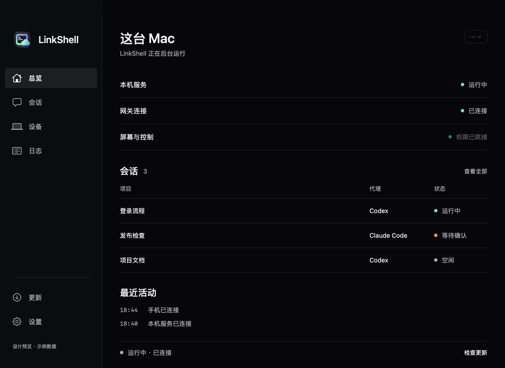
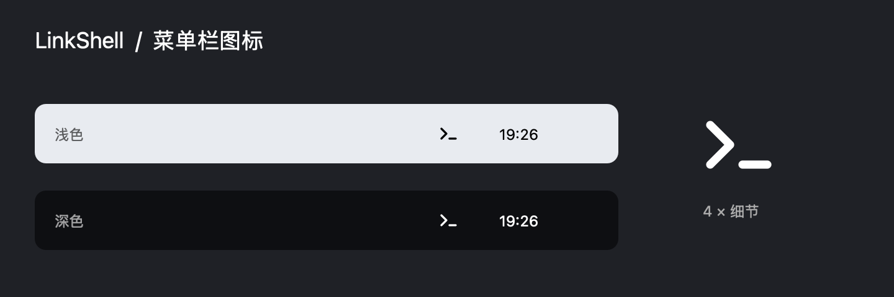

# Mac desktop status app

The approved direction is the website's near-black surfaces, neutral typography, mint status
indicators and original LinkShell icon. The implementation lives in `apps/mac/Sources/LinkShell/Desktop*.swift`.

This image is rendered by the actual SwiftUI implementation with explicit fixture data. It is
not a capture of the user's running sessions. The fixture mode disables service and permission
mutations and does not read local state. The production model reads the CLI's versioned snapshot.

Validation: native arm64/x86_64 bundle build, repository typecheck, CLI and Swift tests, a local
Unix WebSocket fixture exercising running/stopped snapshots, and native navigation/detail UI
checks. An isolated older signed app was upgraded through Sparkle, including Host recovery and unchanged machine/pairing files. The login callback and official gateway connection were verified on a separate fresh data directory. These checks do not establish new media-performance or Intel physical-hardware results.

For standalone DMG packaging, bundled runtime ownership and Sparkle update/recovery behavior,
see `apps/mac/README.md`. Public distribution also requires notarization and feed publication.

## Menu-bar refinement

The template mark is drawn from the same `DesktopStatusIcon` implementation used by NSStatusItem.
The preview shows actual 18-point sizing on the left and enlarged vector detail on the right.
It replaces the colored app tile and adjacent permanent status dot; Dock/Finder keep the app icon.

Brand replacement scope and exports: [designer handoff](../brand/图标交付规格.md).
