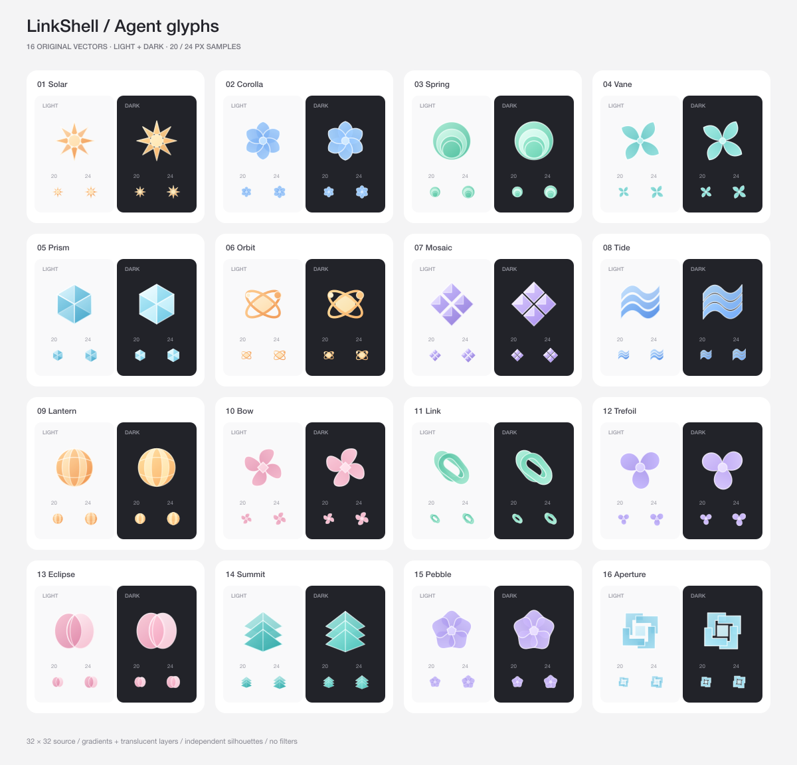

# LinkShell agent glyphs · 2026-10-21

16 original geometric silhouettes, with separate light/dark palettes. These are
drawn from basic geometry in `generate.py`; no extracted Codex SVG paths are used.



## Deliverables

- `light/` and `dark/`: 16 named SVGs each, transparent backgrounds.
- `manifest.json`: stable IDs, palette names, order and file paths.
- `contact-sheet.svg` / `contact-sheet.png`: enlarged light/dark comparison and
  exact 20 px / 24 px samples. Image viewers may scale the complete sheet; open
  at 100% to judge the small samples.
- `generate.py`: complete editable vector source and offline preview generator.
- `linkshell-agent-glyphs.zip`: all of the above.

The source canvas is 32 × 32; shapes use gradients, translucent overlaps and
0.65 px hairline highlights. Orbit rings use 1.6 px strokes for small-size
visibility. There are no raster layers, fonts, external resources, filters,
masks, animation, or CSS dependencies in the individual assets.

Dark assets keep the same geometry but raise fill coverage and use brighter
palettes. This keeps translucent colors legible against dark surfaces.

## Identity and integration

These are **agent identities**, not operation/status icons. Preserve the
existing collection/layers icon for the group-level button. Use the same glyph
for an agent's timeline card, list row and detail header. Show running,
completed, stopped and failed state beside the identity with existing text and
status indicators, without recoloring the glyph to communicate those states.

Recommended drawing sizes: 20 px for compact summaries, 24 px for timeline
items, and 28–32 px for list rows. Keep layout/touch target size independent of
the glyph. The image is decorative when the adjacent label already names the
agent; avoid duplicating accessibility announcements.

For deterministic assignment, use the parent session ID and spawning tool-call
ID from the first render (see the exact shipped v1 mapping below). Do not switch
to a native agent ID that arrives later, or use array index, name, status or
launch order. With only 16 glyphs collisions are normal; the agent's text label
remains authoritative.

If the set is expanded, keep version 1 assignment or persist the selected glyph
ID; taking an old hash modulo a new asset count would change existing agents.
Optional collision avoidance within a visible group should persist the selected
ID and must not shuffle existing agents when another agent is added.

When embedding SVG inline, namespace `main`, `reverse` and `edge` gradient IDs
per rendered instance to avoid document-level ID collisions. Assets loaded as
standalone SVG images already have isolated ID scope. Native SVG package
support and the actual app renderer should be checked during integration.

## Regenerate

```sh
python3 docs/design/subagent-icons-2026-10-21/generate.py
```

Python standard library generates the assets; `/opt/homebrew/bin/rsvg-convert`
renders the contact sheet offline. No network dependency or app build is used.

## Verification and scope

The SVGs were parsed and rendered locally with librsvg 2.63.2. Light/dark
silhouettes and 20/24 px samples were visually reviewed. The light Orbit outline
was strengthened after preview, and dark fill coverage was increased to avoid
muted fills. This is an asset proposal, not a change to the app; native-device
appearance, theme switching and live timeline/list integration remain to be
verified when the proposal is implemented. No source app files were changed.

## Mobile integration (2026-10-21)

The mobile timeline card, sub-agent list and detail header now use
`apps/client/src/components/subagent-glyph.tsx`. Export the reviewed SVGs with
`python3 docs/design/subagent-icons-2026-10-21/export-client.py`; the resulting
TypeScript asset module is bundled by Metro. No new native dependency is needed.

The shipped v1 assignment uses FNV-1a over UTF-16 code units of
`JSON.stringify([parentSessionId, toolCallId])`, modulo the frozen 16 entries.
This deliberately uses the spawning call from the first render, rather than
switching to a native ID when discovery completes. Keep this exact assignment
when adding Web support. Each mounted SVG namespaces gradient IDs with React
`useId`; theme changes only replace the palette. Status remains separate.
Web integration and native device visual validation remain pending.
