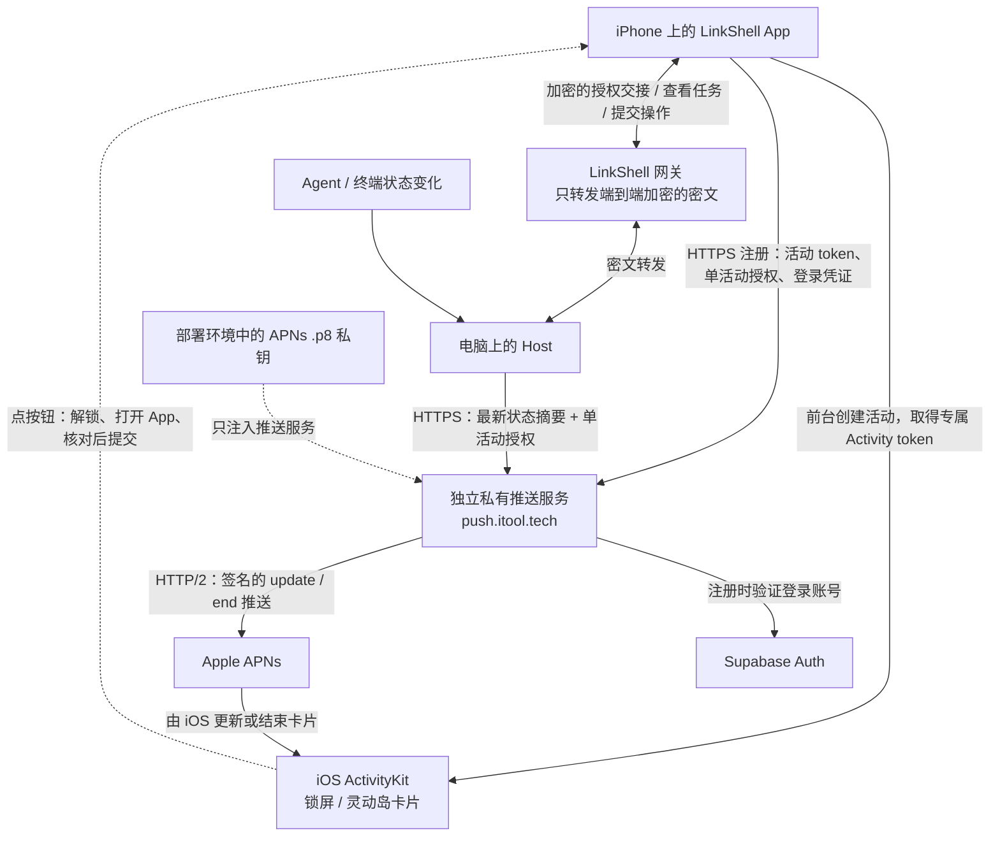

# ActivityKit / APNs 实时活动更新

只更新已有的 iOS 实时活动，不接友盟，不注册传统通知的 device token，不请求通知权限，也不发送 `alert`、声音或角标。TestFlight 和 App Store 使用同一套生产 APNs 配置。推送服务独立维护在私有项目中，开源仓库只包含客户端、Host 和共享协议。APNs 受理与真机显示需要分别验证。

## 需要准备什么

| 项目 | 在哪里准备 | 用途 |
| --- | --- | --- |
| APNs `.p8` 私钥 | Apple Developer → Certificates, Identifiers & Profiles → Keys，创建启用 Apple Push Notifications service 的 Key 并下载 | 只交给 `push.itool.tech` 的服务端签名 |
| Key ID | 上述 Key 的详情页，10 位字符 | 服务端 `APNS_KEY_ID` |
| Team ID | Apple Developer → Membership details | 服务端 `APNS_TEAM_ID`；仓库当前签名团队是 `L95PYLFT86`，Key 应属于同一团队 |
| App ID 推送能力 | Identifiers → `com.bd.linkshell` → 开启 Push Notifications | 重新生成带推送 entitlement 的签名配置 |

如已有合适的 APNs Key，可以复用，无需重复申请。Key 的授权范围必须允许生产环境和 `com.bd.linkshell` 的 Live Activity topic。保管好 `.p8`，Apple 只提供有限的下载机会；无需把私钥发到聊天里，提供本地文件路径即可。

App ID 开启能力后，本地 Release 构建使用现有自动签名流程更新 Provisioning Profile，确认导出 IPA 的 `aps-environment=production`。这是 APNs Key，不是 App Store Connect 上传构建用的 API Key。不需要开发环境证书、友盟 AppKey/Master Secret 或额外的内部 SDK。模拟器布局验证不要求这些生产凭据。

## 配置放在哪里

- 客户端：把 `apps/client/.env.live-activity.example` 中两项合并进 `apps/client/.env.local`。它们只是编译开关和服务地址，不是秘密。
- 服务端：在独立私有项目的环境配置中填 Key ID、Team ID 和完整 `.p8` 的 Base64，具体部署见该项目的 README。现有网关的 Supabase URL/公开 anon key 可复用，仅用于校验登录用户，不需要 service-role key，也不创建 Supabase 表。
- 原始 `.p8` 保存在开源仓库之外。私钥和服务端环境文件在部署时注入 Luma 的 `linkshell-push` 服务作用域，不能复制进镜像。

`.gitignore` 只防止误提交，不能防止配置进入 App 或镜像。仓库也排除了 Docker 上下文中的 `.env*`、`.secrets/`、`.p8`、`.p12`。私钥不得进入 `EXPO_PUBLIC_*`、Expo `extra`、Info.plist、客户端 JS 或构建日志；Base64 只是便于传输，不是加密。

未设置 `LINKSHELL_LIVE_ACTIVITY_PUSH=1` 时，开源构建只使用本地实时活动更新，不依赖官方服务、私有 Registry 或内部包。远程更新仅给生产 bundle 开启；开发变体误开会在配置阶段报错。

## 更新链路

**建立一次活动后，后台更新不依赖 App 的 JS 或手机到网关的连接继续运行。** Host 在电脑上独立观察任务，将最新摘要发给私有服务，Apple 再把它交给 iOS。电脑、推送服务和 Apple 之间仍需要网络；这版必须先在 App 前台创建活动，不支持远程新建卡片。

**按钮操作走 App 到 Host 的加密连接。** App Intent 要求设备认证，打开 App 并交接一次性选择；App 自动选择对应电脑、重连、核对会话和请求仍有效后提交。请求已过期或提交结果不确定时，不会自动重放审批。下面的 token、授权和私钥是三种不同的东西：活动 token 指定哪张卡片，单活动授权允许 Host 更新这一张卡片，`.p8` 私钥只让推送服务向 Apple 证明身份。

1. App 在前台创建 `Activity.request(..., pushType: .token)`，原生持续观察 `pushTokenUpdates`，同时恢复已存在的活动。普通 APNs device token 不能代替这个 token。
2. 已登录的 App 将活动 token 和随机生成的单活动授权交给 HTTPS 服务。服务用 Supabase Auth 的 `/auth/v1/user` 校验账号，活动绑定账号，重复注册和 token 轮换不会延长活动寿命。客户端将授权存入 Keychain。
3. App 通过原有端到端加密的 Host RPC 交接授权、活动 ID 和电脑标识。Host 将它们存到 `~/.linkshell/live-activities.json`（0600）。它不接收 APNs 私钥或账户 refresh token。
4. Host 保留独立的会话订阅；手机 socket 关闭后仍观察 Agent 进度和终端变化，主机重启后恢复授权。约 5 秒合并一次变化，最长约 60 秒发送一次新鲜度更新；出错时退避，重试最新快照。
5. `push.itool.tech` 将摘要通过 HTTP/2 发给 `https://api.push.apple.com`，固定 `apns-push-type: liveactivity` 和 `apns-topic: com.bd.linkshell.push-type.liveactivity`。普通更新优先级 5，新进入待确认/待回答/错误状态和结束用 10；不添加 `alert`。
6. 全部任务结束发送 `event: end`，立即移除活动。Token 失效、撤销、退出登录、用户关闭活动和授权到期会终止相应更新。Host 离线或 APNs 未及时送达时，`stale-date` 让卡片显示内容过期，不能据此断言电脑离线。

服务只持久化账号 ID、活动 token、授权摘要、过期时间和顺序信息，不保存完整会话。为了渲染锁屏，Host 会向推送服务和 Apple 发送经过长度限制的标题、正文摘要、Agent 和选项；这是独立于 E2E 网关的明确数据通路。审批本身仍通过 App 的加密 Host 连接执行，推送服务没有审批接口。

前台和 Host 共用 `packages/wire/src/live-activity.ts`，保证头像排序、标题、正文、按钮和详情链接一致。内容按字节预算收敛到 APNs 的 4 KB 限制；放不下的操作整体移除，保留进入详情的入口，不截断请求或选项 ID。服务拒绝旧序号和突发并行更新；APNs 受理只表示服务端受理，不等于设备已显示。

## 部署与验证

服务作为独立私有项目部署在 `push.itool.tech`，只有生产 APNs 路径。本仓库不包含服务端源码、私有构建依赖、部署清单或密钥。服务使用独立数据卷，不共享网关的配对数据库。

公开接入可运行 `pnpm --filter @linkshell/host test` 与 `pnpm --filter @linkshell/client test` 验证 Host 状态投影、重试和 App 授权交接。未开启远程更新的构建继续使用本地 ActivityKit。

生产验收需要覆盖：带推送能力的生产签名构建、真实 ActivityKit token 注册、App 后台/退出后更新、token 轮换、Host 重启、等待确认、结束/用户关闭和弱网过期验证。布局模拟器与 mock APNs 测试不能证明真实 APNs 投递；未经许可不在日常正式版设备上安装或操作。

Apple 对实时活动寿命和推送频率仍有限制。第一版由前台启动活动，不实现 push-to-start 或无限期保持一张活动；单张活动最长 8 小时，过期后需要重新在 App 中开启。

## 官方资料

- [ActivityKit 推送更新](https://developer.apple.com/documentation/activitykit/starting-and-updating-live-activities-with-activitykit-push-notifications)
- [APNs Token 鉴权 Key](https://developer.apple.com/help/account/capabilities/communicate-with-apns-using-authentication-tokens/)
- [交互式实时活动](https://developer.apple.com/documentation/appintents/liveactivityintent)
